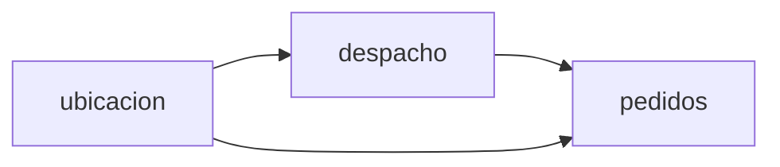

# Rapidos 🛵

Demo de **monolito modular** (Spring Boot + Spring Modulith + PostgreSQL) para una plataforma de domicilios. Implementa, a escala de demo, las decisiones de arquitectura documentadas en **ADR-001, ADR-002 y ADR-003**.

> Estado de los ADR: *Propuesto*. Este proyecto es la validación práctica de esas decisiones.

---

## 1. Objetivo

Entre las **7:00 y las 9:00 p. m. se factura el 70 % del día**. Si el sistema se satura en esa franja, el negocio pierde la mayor parte de sus ingresos. El equipo es Nicolás, Esteban, Matheu, Pipe y Gio, así que se prefiere simplicidad y pocas piezas que operar.

La demo debe mostrar, de punta a punta, que:

1. **Confirmar un pedido es rápido y no se pierde** (ADR-001): la API guarda el pedido, lo publica en una cola, responde la confirmación de inmediato y el aviso al restaurante/repartidor se procesa aparte.
2. **La ubicación GPS no tumba los pedidos** (ADR-002): vive aislada, solo guarda la última posición en memoria con vencimiento y baja su frecuencia (5 s → 10 s → 15 s) si la confirmación se pone lenta.
3. **El estado del pedido siempre pasa antes que el GPS** (ADR-003): los estados van por un canal confiable con reintentos e idempotencia; la ubicación es descartable (el último valor gana).

### ASRs que se cubren

| ASR | Descripción | Meta |
|-----|-------------|------|
| ASR 1 | Procesar el 70 % de los pedidos en el pico | p95 de confirmación < 2 s, 0 % de rechazos por timeout |
| ASR 2 | Sincronizar la confirmación del pedido con el repartidor | p95 < 3 s, sin pérdida de estados |
| ASR 3 | Rastrear la posición del repartidor para el cliente | Ubicación cada 5 s, retraso p95 < 3 s (se puede degradar a propósito para proteger el ASR 1) |

### Resumen de decisiones

| ADR | Decisión | Cómo se refleja en la demo |
|-----|----------|----------------------------|
| 001 | Autoescalado + cola de pedidos; caché de menú; idempotencia por pedido | Cola interna de eventos, workers que avisan, `Idempotency-Key`, caché del menú |
| 002 | Aislar GPS: servicio propio, última posición en memoria con TTL, regla de degradación | Módulo `ubicacion` + `ReglaDegradacionGps` |
| 003 | Separar estado del pedido y GPS en dos canales; el estado tiene prioridad | Módulo `despacho` (estados con llave única) y `ubicacion` (sin cola) |

> **Nota de alcance:** en producción los ADR proponen contenedores (o Lambda) con autoescalado, cola y caché gestionadas. En esta demo todo corre en **un solo proceso Spring Boot**, pero la cola sí es real y persistente (ver sección 3). Lo que se demuestra es el diseño, las fronteras y el comportamiento bajo carga, no la infraestructura de AWS.

---

## 2. Arquitectura: tres módulos, hexagonal

La rama `Hexagonal-Main` deja tres módulos. El menú y el cobro no son módulos: son puertos de `pedidos`. Quién hace cada parte, y en qué rama, está en `RAMAS.md`.



| Módulo | Responsabilidad | Depende de |
|--------|-----------------|------------|
| `pedidos` (orquestador) | Crear pedido, menú con caché, cobro simulado, idempotencia, publicar `PedidoConfirmado` | — |
| `despacho` | Asigna repartidor, aviso al restaurante/repartidor (worker), estados de entrega con llave única | `pedidos` (evento) |
| `ubicacion` | Última posición GPS por repartidor (TTL), lectura por el cliente, degradación de frecuencia | `pedidos` (evento), `despacho` (`ConsultaRepartidor`) |

Los grafos no tienen ciclos. `pedidos` **no** conoce a `despacho` ni a `ubicacion`: se comunica con ellos solo publicando eventos.

### Reglas de frontera (Spring Modulith)

1. Otro módulo solo depende de tipos del **paquete raíz**: eventos (`PedidoConfirmado`, `ConfirmacionMedida`) y `ConsultaRepartidor`. No entra a `dominio`, `aplicacion` ni `infraestructura` ajenos.
2. Dentro del módulo, el servicio habla con puertos. JDBC, caché, HTTP y listeners viven en `infraestructura`.
3. Llamadas entre módulos: eventos donde el ADR habla de cola (aviso al repartidor, medición de latencia). El menú y el cobro no cruzan de módulo: son puertos de `pedidos`.
4. Sin dependencias circulares. `ApplicationModules.of(RapidosApplication.class).verify()` debe pasar.

### Capacidad del documento → módulo → API pública

| Capacidad (ADR) | Módulo | API pública |
|-----------------|--------|-------------|
| Menú servido desde caché (ADR-001) | `pedidos` | `ConsultarMenuUseCase.menu(...)`; el orquestador usa `MenuPort` |
| Guardar pedido y confirmar de inmediato (ADR-001) | `pedidos` | `CrearPedidoUseCase.crear(...)`, `ConsultarPedidoUseCase.consultar(...)` |
| Idempotencia por pedido (ADR-001) | `pedidos` | cabecera `Idempotency-Key` en `CrearPedidoUseCase.crear` |
| Publicar en cola / avisar a restaurante y repartidor (ADR-001) | `pedidos` → `despacho` | evento `PedidoConfirmado` |
| Estados confiables con llave única (ADR-003) | `despacho` | `RegistrarEstadoUseCase.registrarEstado(...)` |
| Ubicación: última posición con TTL (ADR-002/003) | `ubicacion` | `ReportarUbicacionUseCase.reportar(...)`, `ultimaDePedido(...)` |
| Degradación 5 s → 10 s → 15 s (ADR-002) | `ubicacion` | `frecuenciaSugeridaSegundos()`; escucha `ConfirmacionMedida` |

---

## 3. Colas, workers y Lambda: qué implementamos y qué no

### Cola de pedidos (ADR-001) — implementada

No usamos Kafka ni RabbitMQ. Usamos el **registro de publicaciones de Spring Modulith con JDBC** (`spring-modulith-starter-jdbc`), que es una cola persistente sobre el mismo PostgreSQL:

```
POST /api/pedidos
   └─► pedidos: guarda el pedido + publica PedidoConfirmado (misma transacción)
          └─► responde la confirmación al cliente de inmediato
   ·
   · (asíncrono, tabla event_publication = la "cola")
   ·
   └─► despacho (worker): asigna repartidor y avisa a restaurante y repartidor
          ├─ si falla: el evento queda pendiente y se reintenta (también tras reiniciar la app)
          └─ idempotente: llave única por pedido, un reintento no procesa doble
```

| Requisito del ADR-001 | Cómo se cubre en la demo |
|-----------------------|--------------------------|
| "Un pedido aceptado no puede perderse" | El evento se guarda en PostgreSQL junto con el pedido; si la app cae, se reenvía al arrancar |
| "Si un worker falla, otro lo procesa" | Publicación pendiente + reintento (`republish-outstanding-events-on-restart`) |
| "Un mensaje se entrega dos veces" | Llave única por pedido en despacho (idempotencia) |
| "Tope máximo de instancias" | `ThreadPoolTaskExecutor` acotado: `rapidos.workers.max-size` en `application.yml` |
| "Alarma por tamaño de la cola" | `GET /api/cola` devuelve las publicaciones pendientes |
| "Autoescalado por tamaño de cola" | Se documenta (ver abajo); en la demo, el tope de workers y la métrica lo representan |

### AWS Lambda y autoescalado real — no implementado, por decisión

- El ADR dice "Lambda o contenedores con autoescalado": es una **decisión de despliegue**, no de código.
- Un monolito Spring Boot en Lambda sufre arranques en frío, justo lo que el ADR quiere evitar a las 7:00 p. m.
- Sin cuenta de AWS ni red, no aportaría a lo que queremos validar.

En su lugar entregamos:

- **Dockerfile:** la imagen que se escalaría en producción.
- **Prueba de carga** (`carga/pedidos.js`, k6): simula el pico y valida p95 < 2 s y 0 % de rechazos (meta de la sección Verificación del ADR-001).
- La **ruta a producción** de abajo.

### Ruta a producción (no incluida en el código)

| Pieza de la demo | Equivalente en producción |
|------------------|----------------------------|
| Un proceso Spring Boot | Contenedores en un servicio gestionado con autoescalado (o Lambda) |
| Cola en PostgreSQL (`event_publication`) | Cola gestionada (p. ej. Amazon SQS) |
| Caché en memoria (menú, GPS) | Caché gestionada con réplica (p. ej. ElastiCache) |
| Tope de workers en `application.yml` | Tope máximo de instancias + alerta de presupuesto |
| `GET /api/cola` | Alarma por tamaño de cola que dispara el autoescalado |
| — | Precalentar la capacidad antes de las 7:00 p. m. (p. ej. a las 6:45) |

Como `pedidos` solo publica un evento y `despacho` solo lo escucha, cambiar la cola de PostgreSQL por SQS toca el **borde** de esos módulos, no su lógica de negocio. Esa es la ventaja de la frontera modular.

---

## 4. Estructura del proyecto

```
rapidos/
├── docker-compose.yml
├── Dockerfile
├── pom.xml
├── README.md
├── RAMAS.md
├── carga/
│   └── pedidos.js                      (prueba de carga k6)
└── src/
    ├── main/java/com/rapidos/
    │   ├── RapidosApplication.java
    │   ├── pedidos/                        (orquestador)
    │   │   ├── PedidoConfirmado.java       (evento que escucha despacho)
    │   │   ├── ConfirmacionMedida.java     (evento que escucha ubicacion)
    │   │   ├── dominio/                    (pedido y menu)
    │   │   ├── aplicacion/                 (casos de uso, MenuPort, Cobro)
    │   │   └── infraestructura/            (PedidosController, JDBC, caché)
    │   ├── despacho/
    │   │   ├── ConsultaRepartidor.java     (lo único que ve ubicacion)
    │   │   └── dominio, aplicacion, infraestructura
    │   └── ubicacion/
    │       └── dominio, aplicacion, infraestructura
    ├── main/resources/
    │   ├── application.yml
    │   ├── schema.sql
    │   └── data.sql
    └── test/java/com/rapidos/
        ├── ModulosTest.java                (verify() + Documenter)
        └── PedidoFlujoIT.java              (MockMvc, flujo principal)
```

---

## 5. Requisitos

- Java 21
- Docker y Docker Compose
- Maven (o el wrapper `./mvnw`)

## 6. Cómo ejecutar

```bash
# 1. Levantar PostgreSQL local
docker compose up -d

# 2. Correr las pruebas (incluye ApplicationModules.verify())
./mvnw test

# 3. Arrancar la aplicación
./mvnw spring-boot:run

# (opcional) Postman: importar postman/Rapidos-Local.postman_environment.json y las colecciones por módulo
# (Catálogo, Pedidos, Despacho, Ubicación) o postman/Rapidos-Demo-E2E.postman_collection.json para el flujo completo

# (opcional) construir la imagen de contenedor
docker build -t rapidos .

# (opcional) prueba de carga del pico, con la app arrancada (requiere k6)
k6 run carga/pedidos.js
```

Los diagramas de módulos se generan en `target/spring-modulith-docs/` al correr `ModulosTest`.

---

## 7. Caso de uso principal (demo)

**Crear un pedido en el pico → confirmación inmediata → aviso al repartidor → estado → ubicación.**

```bash
# 1. Ver el menú (viene de caché)
curl http://localhost:8080/api/restaurantes/1/menu

# 2. Crear el pedido (responde la confirmación de inmediato)
curl -X POST http://localhost:8080/api/pedidos \
  -H "Content-Type: application/json" \
  -H "Idempotency-Key: pedido-abc-001" \
  -d '{"restauranteId":1,"clienteId":10,"items":[{"itemId":1,"cantidad":2}]}'

# 3. Repetir el mismo comando NO crea un segundo pedido (idempotencia)

# 3b. Ver cuántos eventos hay pendientes en la cola
curl http://localhost:8080/api/cola

# 4. El repartidor cambia el estado (canal confiable)
curl -X POST http://localhost:8080/api/repartidores/5/estado \
  -H "Content-Type: application/json" \
  -d '{"pedidoId":1,"estado":"RECOGIDO","llave":"est-1-recogido"}'

# 5. El repartidor reporta ubicación (solo la última posición gana)
curl -X PUT http://localhost:8080/api/repartidores/5/ubicacion \
  -H "Content-Type: application/json" \
  -d '{"lat":1.2136,"lon":-77.2811}'

# 6. El cliente ve el mapa
curl http://localhost:8080/api/pedidos/1/ubicacion
```

La respuesta de ubicación incluye `frecuenciaSugeridaSegundos` (5, 10 o 15) y la hora de la última posición conocida.

### Reglas de negocio explícitas que implementa la demo

1. **Idempotencia (ADR-001):** la misma `Idempotency-Key` devuelve el mismo pedido; nunca se procesa doble.
2. **Degradación del GPS (ADR-002):** si el p95 de confirmación supera 1,5 s, la frecuencia sugerida pasa de 5 s a 10 s, y a 15 s si la presión sigue; vuelve a 5 s cuando el p95 baja de 1 s.
3. **Cola con reintento (ADR-001):** si el worker de despacho falla, el pedido sigue aceptado y el aviso se reintenta sin duplicarse.
4. **Prioridad de estados (ADR-003):** los estados se registran con llave única (sin duplicados) y la ubicación nunca pasa por la cola de estados.

---

## 8. Pruebas

- `ModulosTest`: `verify()` de Modulith + generación de documentación (`Documenter`).
- `PedidoFlujoIT`: crea un pedido, verifica idempotencia, verifica el evento y el aviso en consola.
- Pruebas unitarias por módulo (las escribe cada dueño del módulo; ver `RAMAS.md`).

### Verificación de los ADR (a escala de demo)

| ADR | Prueba |
|-----|--------|
| 001 | `carga/pedidos.js`: p95 < 2 s y 0 % de rechazos; forzar un fallo del worker y comprobar que el pedido se procesa tras el reintento, sin duplicados |
| 002 | Simular latencia alta → la frecuencia sugerida sube a 10 s y luego 15 s; baja a 5 s al recuperarse |
| 003 | Registrar estados y GPS "sin conexión" → los estados llegan primero y sin duplicados |

---

## 9. Fuera de alcance

- Microservicios, gRPC o mensajería pesada (Kafka, RabbitMQ).
- Autoescalado real, AWS Lambda, SQS y caché gestionada (ver *Ruta a producción* en la sección 3).
- Pasarela de pagos real (el cobro es simulado dentro de `pedidos`).
- Historial de rutas GPS (el ADR-002 lo deja fuera de la ruta crítica).

---

## 10. Equipo y ramas

La línea hexagonal no usa `develop` ni `Nicolas`. Esas dos ramas son Modulith.

| Persona | Rol | Rama | PR hacia |
|---------|-----|------|----------|
| Nicolás | Dev 1, orquestador de `pedidos` | `Nicolas-Hexagonal` | `develop-Hexagonal` |
| Esteban | Dev 2, menú dentro de `pedidos` | `esteban-Hexagonal` | `develop-Hexagonal` |
| Matheu | Dev 3, `despacho` | `matheu-Hexagonal` | `develop-Hexagonal` |
| Pipe | Dev 4, `ubicacion` | `pipe-Hexagonal` | `develop-Hexagonal` |
| Gio | Dev 5, DTOs, SQL y pruebas del pedido | `Gio-Hexagonal` | `develop-Hexagonal` |

`develop-Hexagonal` sale de `Hexagonal-Main` y junta los PR. El paso a paso de cada rama está en **[RAMAS.md](RAMAS.md)**.
